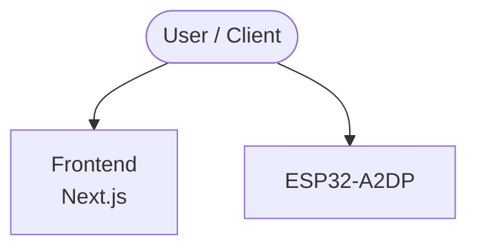

# Context Map — `ESP32-A2DP`

> Auto-generated architecture & deployment context map. Summarizes the core application, container/cloud footprint, and database connections. Regenerate after significant structural changes.

**Repo:** `avnit/ESP32-A2DP` · **Fork** · Public · Primary language: C++ · Default branch: `main` · Files: 438

**Description:** A Simple ESP32 Bluetooth A2DP Library (to implement a Music Receiver or Sender) that supports Arduino, PlatformIO and Espressif IDF

## 1. Core application

A Simple ESP32 Bluetooth A2DP Audio Library

- **Frameworks / runtime:** Next.js

## 2. Containers & cloud applications

_No container, Kubernetes, IaC, or cloud-deploy manifests detected. Runs as a local script/library or static site._

## 3. Database connections

_No database drivers or connection strings detected._

## 4. Architecture diagram

## 5. Security posture

- **Static scan findings:** 1 high, 8 medium

| Severity | Rule | File:Line |
|---|---|---|
| high | js-eval | `docs/html/jquery.js:34` |
| medium | js-innerhtml | `docs/html/jquery.js:2` |
| medium | js-innerhtml | `docs/html/search/search.js:254` |
| medium | js-innerhtml | `docs/html/search/search.js:258` |
| medium | js-innerhtml | `docs/html/search/search.js:747` |
| medium | js-innerhtml | `docs/html/search/search.js:760` |
| medium | js-innerhtml | `docs/html/search/search.js:776` |
| medium | js-innerhtml | `docs/html/search/search.js:800` |

---
_Generated by repo context-mapping pass on 2026-08-13._